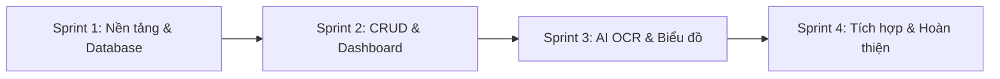

# 📋 Kế Hoạch Phân Chia Công Việc & Lộ Trình Triển Khai Dự Án

> **Môn học:** Lập trình Thiết bị Di động (Mobile Application Development)  
> **Dự án:** Ứng Dụng Quản Lý Chi Tiêu Cá Nhân (Personal Expense Tracker)  
> **Nhóm thực hiện:** Nhóm 16 - Lớp CSE441  
> **Nền tảng:** Flutter (Cross-platform Android / iOS)  

---

## 👥 1. Bảng phân công nhiệm vụ chi tiết theo thành viên

| STT | MSSV | Họ và tên | Vai trò | Nhiệm vụ chính phụ trách | Module & Deliverables (Sản phẩm bàn giao) | Nhánh Git đề xuất |
|:---:|:---:|:---|:---:|:---|:---|:---|
| **1** | **2351170599** | **Nguyễn Văn Huỳnh** | **Nhóm trưởng** (Team Lead / Core UI) | • Khởi tạo và thiết lập khung dự án Flutter (Clean Architecture / Feature-First). • Cấu hình State Management (`Provider`/`Bloc`/`Riverpod`) & Theme chung (Light/Dark). • Xây dựng màn hình **Dashboard / Home Screen** (tổng quan tài chính, số dư, tóm tắt thu chi). • Xây dựng module **Quản lý danh mục (Category Management)** (thêm, sửa, chọn icon/màu sắc danh mục thu chi). • Điều phối tiến độ, review và duyệt Pull Request, merge code, kiểm thử tích hợp. | • Project setup & Navigation flow. • `HomeScreen`, `CategoryScreen`. • Theme & Common Widgets. • Tài liệu báo cáo & điều phối nhóm. | `feature/core-setup` `feature/home-screen` `feature/category-management` |
| **2** | **2151060296** | **Lê Anh Tuấn** | **Thành viên** (Database & Core CRUD) | • Thiết kế cấu trúc cơ sở dữ liệu ngoại tuyến (**SQLite / Hive**). • Tạo Data Models (`TransactionModel`, `CategoryModel`) & Data Sources, Repositories. • Xây dựng toàn bộ nghiệp vụ **CRUD Giao dịch Thu - Chi**. • Xây dựng màn hình **Thêm / Sửa / Xóa giao dịch** (Form nhập số tiền, ngày giờ, danh mục, ghi chú, đính kèm ảnh). • Xây dựng màn hình **Lịch sử giao dịch & Bộ lọc tìm kiếm** (theo khoảng ngày, loại thu/chi, danh mục). | • `DatabaseHelper` & Models. • `TransactionRepository`. • `AddTransactionScreen`. • `TransactionHistoryScreen` & Filter logic. | `feature/local-database` `feature/transaction-crud` `feature/transaction-history` |
| **3** | **2251172394** | **NGUYỄN TRUNG KIÊN** | **Thành viên** (AI OCR & Media) | • Tích hợp `image_picker` và Camera để chụp/chọn ảnh hóa đơn. • Tích hợp thư viện AI **`google_mlkit_text_recognition`** để nhận diện văn bản từ ảnh hóa đơn. • Xây dựng thuật toán Regex / NLP bóc tách thông tin cốt lõi: **Tổng số tiền**, **Ngày tháng**, **Tên đơn vị/cửa hàng**. • Xây dựng màn hình **Quét hóa đơn (Receipt Scanner Screen)** & cơ chế tự động điền (Auto-fill) dữ liệu bóc tách được sang form thêm giao dịch. | • `ReceiptScannerScreen`. • `OcrService` & Text parser helper. • Tự động điền dữ liệu bóc tách sang form thêm thu/chi. | `feature/receipt-scanner` `feature/ocr-text-recognition` |
| **4** | **2351170629** | **Trần Anh Tuấn** | **Thành viên** (Analytics & Utilities) | • Tích hợp thư viện biểu đồ **`fl_chart`**. • Xây dựng màn hình **Báo cáo & Thống kê (Reports / Analytics Screen)**: &emsp;+ Biểu đồ tròn (Pie Chart): Tỷ lệ chi tiêu theo danh mục. &emsp;+ Biểu đồ cột / đường (Bar / Line Chart): Xu hướng thu - chi theo tuần / tháng / năm. • Xây dựng logic tính toán thống kê (Tổng thu, tổng chi, số dư ròng, cảnh báo chi tiêu vượt ngân sách). • Xây dựng tính năng bổ trợ: Xuất báo cáo (CSV/Excel/PDF) và trang Cài đặt (đơn vị tiền tệ, thông tin tác giả). | • `AnalyticsScreen` & Chart widgets. • `ReportService` & Data aggregation logic. • `SettingsScreen` & Export data module. | `feature/charts-analytics` `feature/reports-export` `feature/settings-screen` |

---

## 📅 2. Lộ trình triển khai dự án (Sprint Milestones)

### 🔹 Sprint 1: Khởi tạo nền tảng & Thiết kế dữ liệu (Tuần 1)
* **Mục tiêu:** Toàn bộ thành viên clone repo, thống nhất công nghệ và chạy được skeleton app.
* **Công việc cụ thể:**
  * **Nguyễn Văn Huỳnh:** Khởi tạo project Flutter, cài đặt cấu trúc thư mục chuẩn, cấu hình Theme, thiết lập Bottom Navigation Bar.
  * **Lê Anh Tuấn:** Thiết kế cấu trúc bảng SQLite/Hive, viết `DatabaseHelper`, định nghĩa `TransactionModel`, `CategoryModel`.
  * **Nguyễn Trung Kiên:** Cấu hình quyền truy cập Camera/Gallery trên Android (`AndroidManifest.xml`) và iOS, test thử nghiệm thư viện OCR.
  * **Trần Anh Tuấn:** Cài đặt thư viện `fl_chart`, viết màn hình mockup biểu đồ với dữ liệu tĩnh (mock data).

### 🔹 Sprint 2: Phát triển chức năng nghiệp vụ cốt lõi (Tuần 2)
* **Mục tiêu:** Hoàn thiện luồng nhập dữ liệu thu chi thủ công và xem danh sách giao dịch.
* **Công việc cụ thể:**
  * **Nguyễn Văn Huỳnh:** Hoàn thiện `HomeScreen` hiển thị số dư ví, danh sách giao dịch gần đây, chức năng quản lý danh mục thu/chi (`CategoryScreen`).
  * **Lê Anh Tuấn:** Xây dựng hoàn chỉnh `AddTransactionScreen` (nhập số tiền, chọn ngày, danh mục, lưu vào SQLite/Hive), kiểm tra hiển thị lịch sử giao dịch.
  * **Nguyễn Trung Kiên:** Hoàn thiện chức năng chụp/chọn ảnh hóa đơn, hiển thị ảnh xem trước (preview) và xử lý nén ảnh tối ưu dung lượng.
  * **Trần Anh Tuấn:** Hoàn thiện màn hình `AnalyticsScreen`, viết hàm truy vấn nhóm chi tiêu theo từng danh mục.

### 🔹 Sprint 3: Tính năng nâng cao AI OCR & Biểu đồ trực quan (Tuần 3)
* **Mục tiêu:** Tích hợp AI quét hóa đơn tự động và biểu đồ phân tích trực quan.
* **Công việc cụ thể:**
  * **Nguyễn Văn Huỳnh:** Kiểm thử tích hợp UI, tinh chỉnh giao diện đồng bộ, xử lý các trạng thái rỗng (Empty state), xử lý Dark Theme.
  * **Lê Anh Tuấn:** Xây dựng bộ lọc giao dịch nâng cao (theo khoảng thời gian từ ngày - đến ngày, theo loại thu/chi), tính năng xóa/chỉnh sửa giao dịch.
  * **Nguyễn Trung Kiên:** Tích hợp `google_mlkit_text_recognition`, viết biểu thức chính quy (Regex) bóc tách tổng tiền và ngày tháng, liên kết tự động truyền dữ liệu sang `AddTransactionScreen`.
  * **Trần Anh Tuấn:** Kết nối biểu đồ với dữ liệu thực từ SQLite, hoàn thiện biểu đồ tròn (Pie chart) và biểu đồ cột (Bar chart) lọc theo tuần/tháng/năm.

### 🔹 Sprint 4: Ghép nối, Kiểm thử & Đóng gói báo cáo (Tuần 4)
* **Mục tiêu:** Ứng dụng hoạt động ổn định không lỗi, chuẩn bị sản phẩm nộp môn học.
* **Công việc cụ thể:**
  * **Cả nhóm:** Kiểm thử toàn diện trên thiết bị thật (Android / iOS), kiểm tra xử lý lỗi, validate dữ liệu đầu vào.
  * **Trần Anh Tuấn & Lê Anh Tuấn:** Hoàn thiện tính năng xuất dữ liệu (nếu có) và trang Cài đặt.
  * **Nguyễn Văn Huỳnh & Nguyễn Trung Kiên:** Tổng hợp tài liệu báo cáo dự án (Word/PDF), làm slide thuyết trình, quay video demo ứng dụng.
  * **Nguyễn Văn Huỳnh:** Rà soát mã nguồn, dọn dẹp các nhánh Git thừa, đóng gói file APK nộp bài.

---

## 🌿 3. Quy định làm việc với Git & Phối hợp nhóm

1. **Quy tắc nhánh (Branching):**
   * Tuyệt đối **không commit trực tiếp lên nhánh `main`**.
   * Nhánh mới tạo từ `main` theo cú pháp: `feature/<tên-tính-năng>` hoặc `fix/<tên-lỗi>`.
2. **Quy chuẩn Commit:**
   * `feat:` Tính năng mới (VD: `feat: add transaction form validation`).
   * `fix:` Sửa lỗi (VD: `fix: chart calculation overflow`).
   * `docs:` Cập nhật tài liệu (VD: `docs: update task assignment`).
   * `ui:` Cập nhật giao diện (VD: `ui: improve dashboard dark mode`).
3. **Quy trình Pull Request (PR):**
   * Sau khi hoàn thành tính năng trên nhánh riêng, tạo Pull Request vào `main`.
   * Gán ít nhất 1 thành viên khác (hoặc Nhóm trưởng) làm **Reviewer**.
   * Đảm bảo app build không lỗi trước khi bấm merge vào `main`.
